 

 

<b>PRODUCT & DESIGN</b> 
     
<b>Discovery</b> &nbsp;·&nbsp; User interviews · Jobs to be Done · Opportunity solution trees · Competitive analysis 
<b>Planning</b> &nbsp;·&nbsp; PRDs and specs · RICE / ICE · MoSCoW · Roadmapping · OKRs 
<b>Delivery</b> &nbsp;·&nbsp; Scrum (PSPO I) · Agile / SAFe · Kanban · Stakeholder management · RAID logs · Release planning

 

<b>ANALYTICS & RESEARCH</b> 
      
<b>Methods</b> &nbsp;·&nbsp; Product metrics (North Star, AARRR, HEART) · A/B testing · Funnel and drop-off analysis · Usability testing · Surveys, NPS and CSAT

 

<b>AI</b> 
        
<b>Skills</b> &nbsp;·&nbsp; LLM evaluations · RAG · AI guardrails and governance · Agents · NLP · Classic ML

 

<b>PROTOTYPING</b> 
        

 

&nbsp;&nbsp;
